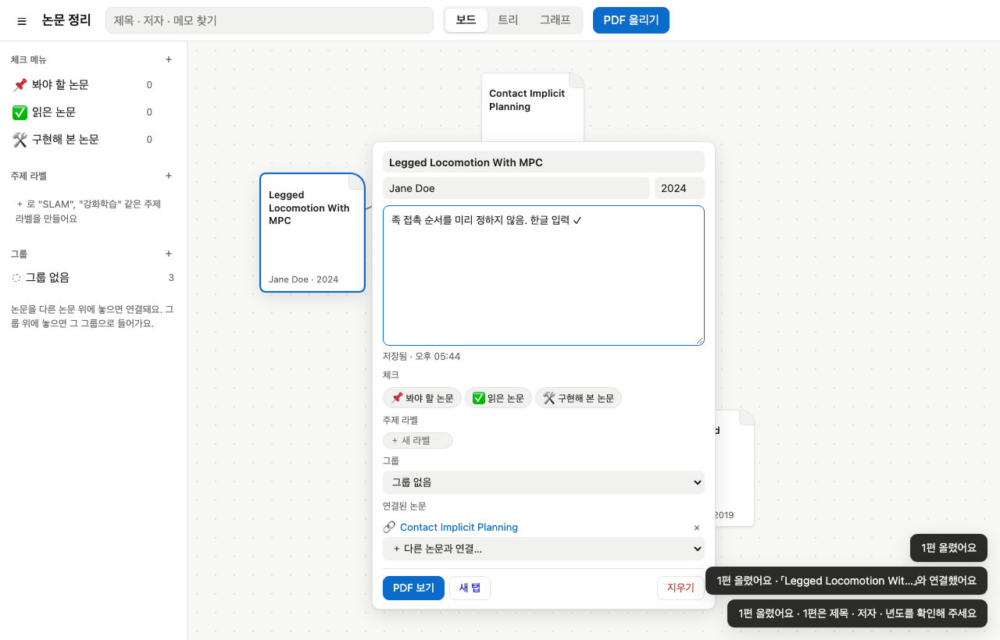
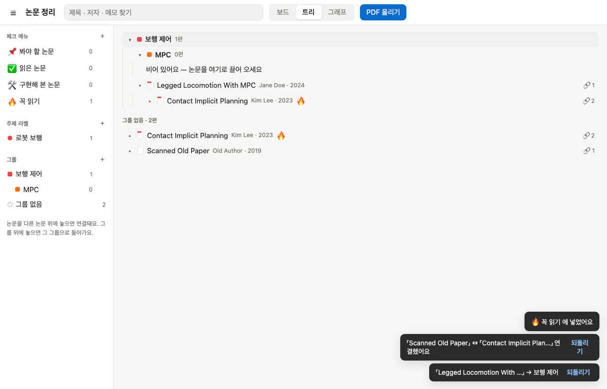
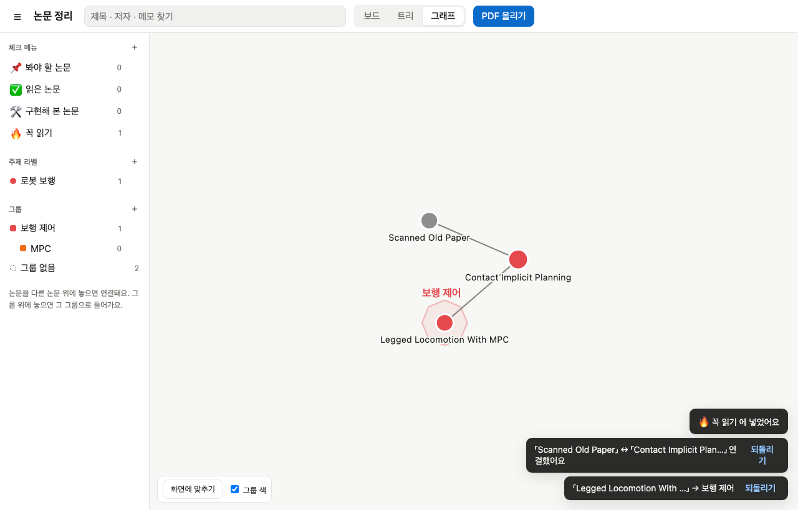
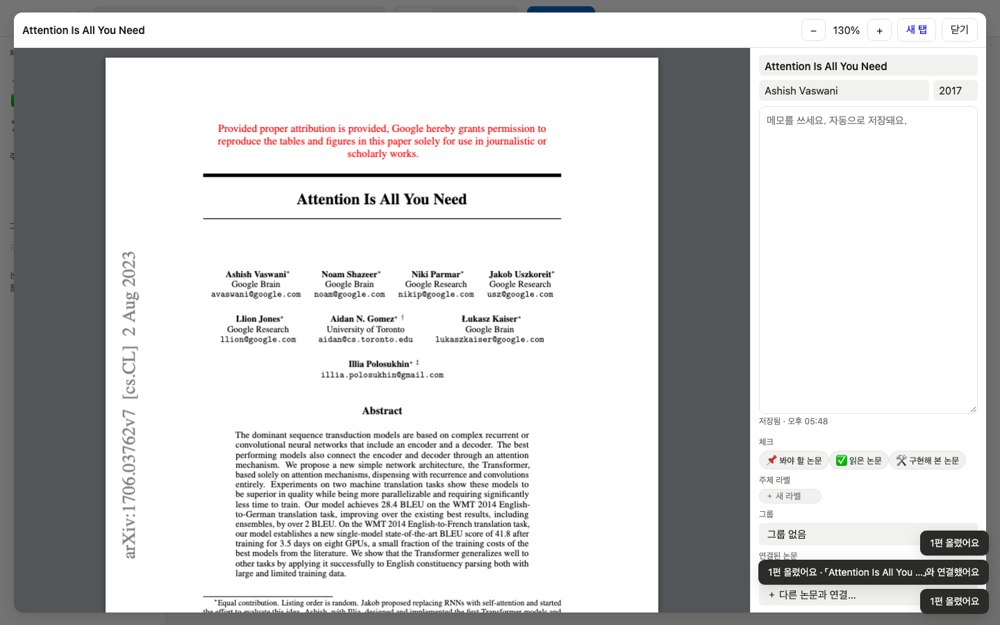

# 논문 정리 (paper organizer)

맥 미니를 서버로 쓰는 논문 정리 웹. 옵시디언처럼 논문끼리 **링크 · 그래프**로 잇고, 노션처럼 **주제 라벨 · 체크 메뉴**를 붙인다.
PDF · 메모 · 링크는 전부 이 맥의 로컬 폴더에 저장된다. 외부 서비스 없음, 빌드 없음(의존성은 PDF 를 읽는 `pdfjs-dist` 하나).

## 쓰는 법

| 하고 싶은 것 | 이렇게 |
|---|---|
| 논문 올리기 | PDF 를 화면 아무 데나 끌어다 놓기 (또는 「PDF 올리기」). 제목 · 주저자 · 년도를 PDF 메타데이터와 첫 페이지 글자 크기로 읽는다 |
| 잘못 읽은 값 고치기 | 아이콘 누르기 → 팝업 맨 위 제목 · 저자 · 년도 칸을 고치면 자동 저장. 못 읽은 논문엔 `⚠ 확인` 표시 |
| 메모 보기 / 쓰기 | 아이콘에 마우스 올리기 = 메모 미리보기. 누르기 = 팝업이 커지며 바로 편집 (0.5초 뒤 자동 저장) |
| 논문 잇기 | 아이콘을 다른 논문 위에 끌어다 놓기. **새 PDF 를 기존 논문 위에 놓아도** 올리면서 바로 연결. 팝업의 「다른 논문과 연결…」로도 가능 |
| 링크 끊기 | 팝업 「연결된 논문」의 × · 연결 직후 알림의 「되돌리기」 |
| 그룹 · 트리 | 왼쪽 「그룹」 ＋. 논문을 그룹 위에 놓으면 들어감. 그룹을 그룹 위에 놓으면 안쪽 그룹. 트리 보기에서 ▸ 를 누르면 연결된 논문이 가지로 펼쳐짐 |
| 라벨 · 체크 메뉴 | 왼쪽 「주제 라벨」 · 「체크 메뉴」 ＋ (체크 메뉴는 `🔥 꼭 읽기` 처럼 앞에 이모지를 쓰면 아이콘). 논문을 그 메뉴 위에 놓거나 팝업에서 눌러 붙임. 메뉴를 누르면 그 논문만 보임 |
| 보드 확대 · 이동 | 마우스 휠 · 트랙패드 핀치 = 커서 자리 기준 확대/축소. 트랙패드 두 손가락 쓸기 · 스페이스+끌기 · 가운데 단추 끌기 = 화면 이동. 왼쪽 아래 `− 100% +` · 「원래 크기」 · 「전체 보기」. 폰: 두 손가락 핀치 · 한 손가락 끌기 |
| 여러 개 선택 | 보드 빈 곳에서 끌면 사각형 안의 논문이 모두 선택됨. 시프트/커맨드 클릭으로 더하고 빼기, Esc 또는 빈 곳 클릭으로 풀기. 선택된 것 하나를 끌면 같이 움직임(위치 저장). 여러 개를 다른 논문 위에 놓으면 **링크는 안 만들고** 그 자리로 옮김. 그룹 · 라벨 · 체크 메뉴 위에 놓으면 모두에 적용 |
| 보기 전환 | 위의 보드(자유 배치) · 트리(그룹 폴더 + 연결 가지) · 그래프(링크 · 그룹 테두리, 끌기 · 휠 확대) |
| PDF 읽기 | 팝업 「PDF 보기」 = 앱 안 열람기(오른쪽에 메모 칸) · 「새 탭」 = 브라우저 PDF 보기(글자 찾기 · 인쇄) |

## 서버 (맥 미니)

```bash
npm install
./scripts/install-launchd.sh      # launchd 상시 실행 + tailscale serve (테일넷 전용, Funnel 아님)
```

- 서버: `127.0.0.1:8790` (launchd `lab.paper-organizer`, 죽으면 다시 뜸, 로그 `~/Library/Logs/paper-organizer.log`)
- 주소: `https://<맥 MagicDNS 이름>:8443` — `tailscale funnel` 로 **인터넷에 공개**(테일스케일 없이 아무 데서나).
  테일넷 안에서만 쓰려면 `tailscale funnel --https=8443 off` 뒤 `tailscale serve --bg --https=8443 http://127.0.0.1:8790`.
- **로그인:** 비밀번호 하나. `npm run set-password` 가 강한 비밀번호(20자)를 새로 만들어 한 번만 보여 주고,
  scrypt 해시만 `DATA_DIR/auth.json`(권한 600)에 저장한다(저장소에는 없음). 바꾸면 기존 로그인은 모두 끊기고 서버 재시작은 필요 없다.
  `PASSWORD='...' npm run set-password` 로 직접 정할 수도 있다(12자 이상).
  - 세션 쿠키 `po_session`: HttpOnly · Secure · SameSite=Lax · 30일. 서버에는 토큰의 sha256 만 저장
  - 실패 제한: 한 주소에서 15분에 5번 틀리면 15분 잠금, 전체로 1시간에 30번 틀리면 모든 로그인 15분 잠금
  - 로그인 없이 열리는 것은 `/login` 화면(+ 그 css · js · 아이콘)과 `/api/health`(`{ok:true}` 만)뿐. 나머지 API · PDF 는 401, 화면은 `/login` 으로
  - 다른 출처(Origin)에서 온 쓰기 요청은 403 · CSP · nosniff · frame 금지 머리글
  - 비밀번호가 설정 안 돼 있으면 모든 요청을 막는다(열린 채로 뜨지 않음)
- 데이터: `~/lab/paper-organizer-data/` (`DATA_DIR` 로 바꿈)
  - `db.json` 논문 · 메모 · 링크 · 라벨 · 체크 · 그룹 (임시 파일에 쓰고 rename)
  - `pdfs/<id>.pdf` 원본 · `trash/` 지운 논문의 PDF · `backups/db-날짜.json` 하루 한 번 사본(30일)
- 멈추기: `launchctl bootout gui/$(id -u)/lab.paper-organizer` · 공개 끄기: `tailscale funnel --https=8443 off`
- Funnel 길은 느리다: 이 맥에서 공개 주소로 돌아 들어와 잰 값은 요청마다 약 2.5초 + 약 70KB/s(테일넷 안은 0.03초). 그래서 글자 파일은 gzip, pdf.js 는 하루 묵힘

## 시험

```bash
npm test                 # 서버 · 추출 · 저장 (node:test)
npm run setup:e2e        # 처음 한 번: 시험용 Chromium 을 .pw-browsers/ 에 받음
npm run test:e2e         # 실제 브라우저로 끌어다 놓기 · 팝업 · 링크 · 트리 · 그래프 · 열람 · 다크 모드
SHOTS=shots npm run test:e2e   # 스크린샷 남기기
```

Node 26 에서 `playwright install` 이 EPIPE 로 죽으면 Node 24 로 받는다:
`PLAYWRIGHT_BROWSERS_PATH=$PWD/.pw-browsers /opt/homebrew/opt/node@24/bin/node node_modules/playwright/cli.js install chromium-headless-shell`

## 화면





